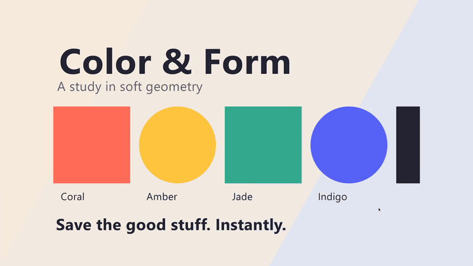

<p align="center">
  
</p>

<h1 align="center">Stash</h1>

<p align="center">
  <b>Capture inspiration in one hotkey and one drag.</b><br>
  A tiny, instant, local-first capture tray app for Windows.
</p>

<p align="center">
  
</p>

Inspiration is fleeting. If saving it takes a dialog, a filename, or a folder
picker, you won't do it. Stash makes capture cost **one hotkey and one drag**,
and saves with no further input.

## Features

- **Instant region snip**: tap `Ctrl+Alt+S`, drag a rectangle, release. It's saved as a PNG before you can blink. The screen is frozen at key-down, so you can catch video frames and hover states.
- **Radial wheel**: hold the hotkey and flick toward a wedge: region, window, full screen, selection, clipboard, quick note, gallery, settings, pause.
- **Stash anything**: images, selected text, links, files. Browser captures record the page URL.
- **Click-to-caption popup**: a non-focus-stealing toast confirms the save. Click it only if you want to add a caption.
- **Gallery**: masonry grid, instant search, colour filter, boards, shuffle view, drag items straight out into Figma, Notion, Miro or Explorer.
- **Auto metadata**: source window, URL, timestamp, colour palette, and OCR text, so you can search screenshots by what's written in them.
- **Your files, your folder**: the library is plain files plus a JSON sidecar per item. No database needed to read it, and it works fine inside a synced folder.
- **Light on resources**: nothing polls, no windows are open when idle, and there is no network access, no account, and no telemetry.
- Light, dark and glass themes; follows your Windows accent colour.

## Install

Download the latest `Stash_x.y.z_x64-setup.exe` from the
[Releases](https://github.com/tracesfx/stash/releases/latest) page and run it
(per-user install, no admin rights needed). A portable `stash.exe` is also
attached to each release.

Requires Windows 10/11 with the WebView2 runtime (preinstalled on Windows 11).

> The build is not code-signed yet, so Windows SmartScreen may warn on first
> run. Choose **More info → Run anyway**.

## Usage

| Action | How |
|---|---|
| Snip a region | Tap `Ctrl+Alt+S`, drag, release |
| Open the wheel | Hold `Ctrl+Alt+S`, move toward a wedge, release |
| Cancel | `Esc`, or release in the wheel's centre |
| Open gallery | Left-click the tray icon |
| Add a caption | Click the confirmation popup |

The library lives in `Pictures\Stash` by default (`YYYY-MM/<id>.<ext>` plus
`<id>.json`). Change the location, hotkey, theme and more in Settings.
Deleted items go to `.trash` inside the library and are recoverable.

## Build from source

Prerequisites: Node 20+, Rust (stable, MSVC toolchain), and the WebView2 runtime.

```powershell
npm install
npm run tauri dev      # development
npm run tauri build    # release build + NSIS installer
```

Output: `src-tauri/target/release/stash.exe` and
`src-tauri/target/release/bundle/nsis/`.

Design notes and requirements live in [SPEC.md](SPEC.md).

## License

[MIT](LICENSE)
