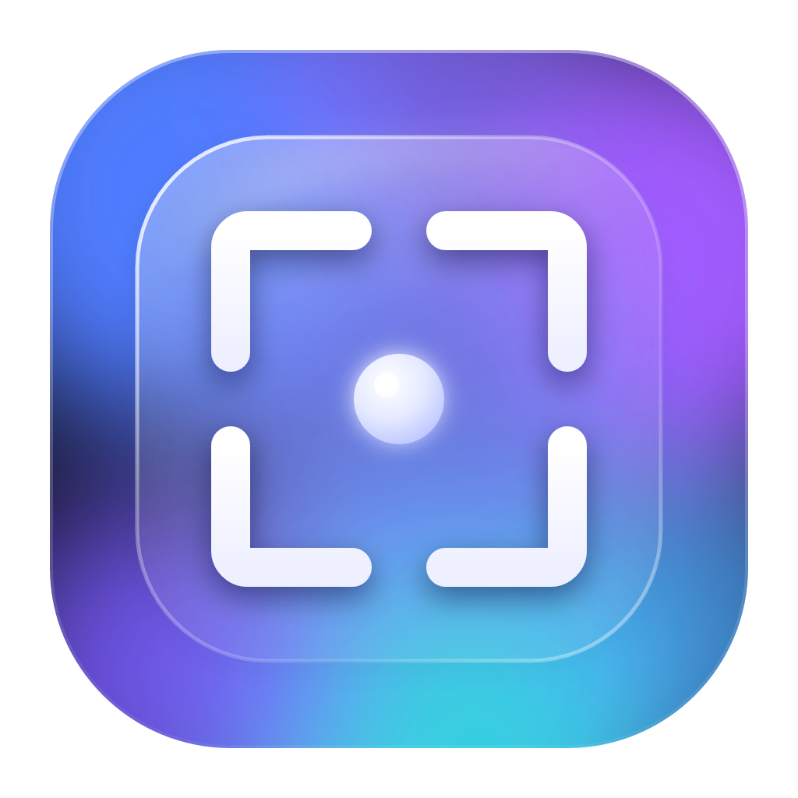
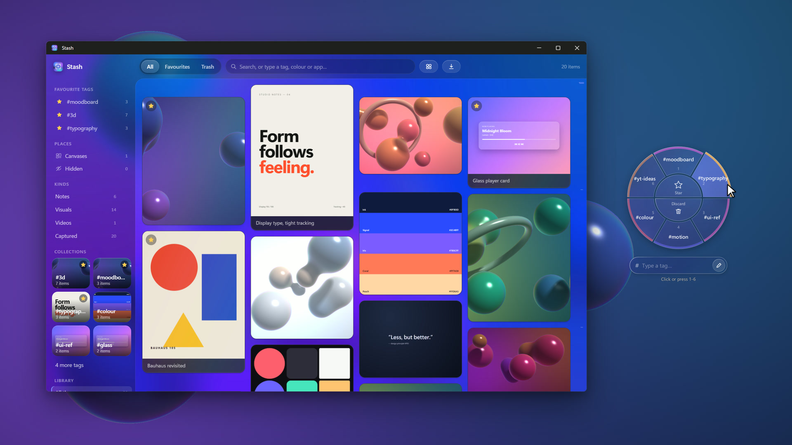
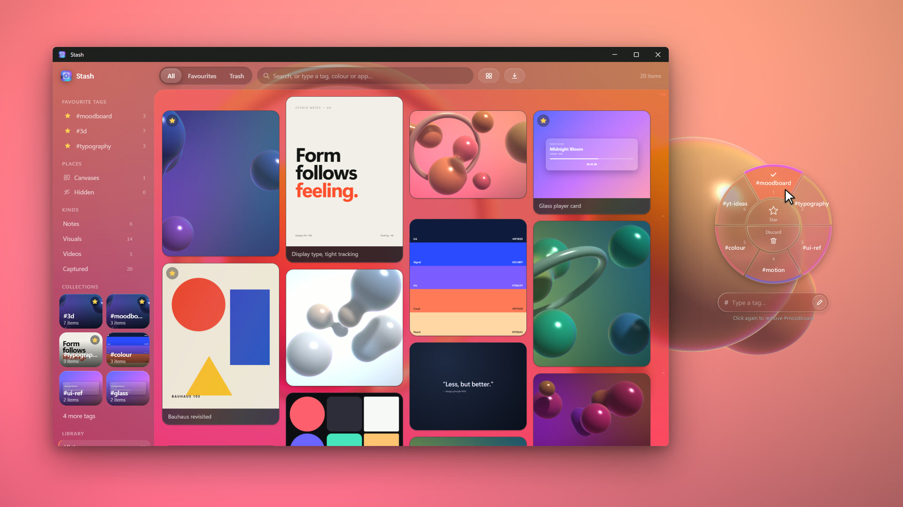

  

<h1 align="center">Stash</h1>

  <b>Save anything that inspires you, in one keystroke.</b> 
  A tiny, instant capture app for Windows.

  

## What it does

- **Snip in a second.** Press `Ctrl+Alt+S`, drag over anything on screen, let go. It's saved. No dialogs, no file names.
- **Tag as you go.** A glass ring of your tags pops up at the cursor. Click one, type a new one, or just move on.
- **Hold for more.** Hold the shortcut for a wheel: quick note, screen recording, window or full screen, and more.
- **Find it again.** A fast, good-looking gallery with search, tags, favourites and colour filters. It can even find text inside screenshots.
- **Drag it out.** Drop items straight into Figma, Notion, Miro or a folder. Arrange them on canvases.
- **Yours, on your PC.** Everything is plain files in a folder you choose. No account, no cloud, no tracking.
- **Make it yours.** Tune the Liquid Glass look: blur, tint, colours, animations and frame rate.

  

## Install

1. Download `Stash_x.y.z_x64-setup.exe` from the [latest release](https://github.com/tracesfx/stash/releases/latest).
2. Run it. No admin rights needed. (Prefer no install? Grab the portable `.exe` instead.)
3. Stash lives in your tray. Press `Ctrl+Alt+S` to capture.

Windows 10 or 11. Windows may show a SmartScreen warning because the app isn't signed yet: choose **More info → Run anyway**.

## Quick reference

| To | Do this |
|---|---|
| Snip part of the screen | Tap `Ctrl+Alt+S`, drag, release |
| Open the wheel | Hold `Ctrl+Alt+S`, point at an option, release |
| Tag a capture | Click a tag in the ring, or press 1-6, or type and press Enter |
| Add a caption | Press `Tab` in the ring |
| Open the gallery | Click the tray icon |
| Cancel | `Esc` |

Your captures are saved in `Pictures\Stash` (you can change this in Settings). Deleted items stay in the Trash for 30 days.

---

Free and open source under the [MIT license](LICENSE). Developers: see [SPEC.md](SPEC.md) for how it's built; `npm install` then `npm run tauri build`.
